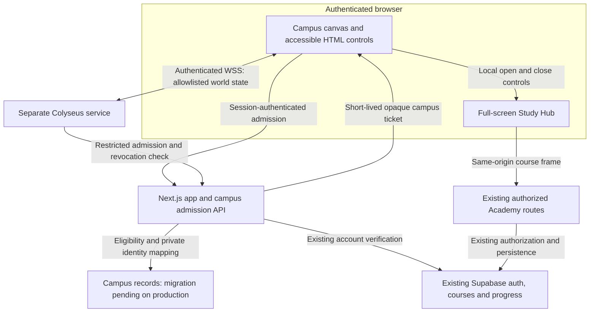

# ScienceDojo architecture and proposed virtual campus

Updated 17 October 2026. The campus foundation and first study slice are implemented locally. Live configuration is only established where separately recorded; the campus migration has not been applied to production and no pilot has launched. Read the [Phase 0 decisions and launch gates](virtual-sciencedojo-phase-0.md) and [implementation/runbook record](virtual-sciencedojo-implementation.md) before continuing.

## Existing platform and evidence

| Capability | Repository evidence | Reuse or constraint |
| --- | --- | --- |
| Web application | [package.json](../package.json), [Next configuration](../next.config.ts) | Next.js 16.2.1, React 19.2.4 and TypeScript; retain current App Router structure and standalone output |
| Authentication | [Supabase server clients](../utils/supabase/server.ts), [session refresh helper](../utils/supabase/middleware.ts), [request proxy](../proxy.ts) | Campus page/API session refresh is now wired in the proxy; handlers independently verify admission |
| Enrollment and access | [course pilot service](../lib/course-pilot.ts), [migration 067](../sql/067_course_pilot.sql), [course pilot guide](course-pilot.md) | Existing verified/active-account checks, ten-place enrollment cap, waitlist, published-course access and RLS; campus invitations grant none of these entitlements |
| Course UI and progress | [learner course layout](../app/dashboard/academy/[courseKey]/layout.tsx), [progress service](../lib/tutor-academy-progress.ts), [learner lesson route](../app/dashboard/academy/[courseKey]/lessons/[lessonSlug]/page.tsx) | Reuse actual course routes and persistence; preserve managed enrollment and legacy audience access rules |
| Identity on course surfaces | [course pilot guide](course-pilot.md), [course utility links](../components/tutor-academy/AcademyCourseUtilityLinks.tsx) | Discussions show profile names/avatars; public reviews show names; private notes have owner-only access |
| Feature controls | [feature flag service](../lib/feature-flags.ts) | Extend existing definitions with a default-disabled campus flag; authorize every admission independently |
| Staff safety tooling | [existing safeguard actions](../app/dashboard/admin/safeguards/actions.ts) | Existing message-review workflow is not campus report/block tooling or proof of a staffed moderation service |
| Hosting | [Vercel configuration](../vercel.json), [historical release record](business-website-release.md) | Repository configuration and prior Vercel deployment evidence exist; current production hosting metadata has been checked privately. Broader account/vendor review remains pending |
| Telemetry and browser policy | [root layout](../app/layout.tsx), [Next configuration](../next.config.ts) | Review existing analytics/pixels and CSP before adding campus routes, frames or a WebSocket origin |

The app now declares Three.js 0.186.1, React Three Fiber 9.8.2 and Colyseus SDK 0.18.5; the separate service pins Colyseus core 0.18.19 and WebSocket transport 0.18.4. LiveKit remains deferred. Do not rerun historical SQL files as an installation script: some early migrations reset tables. The new [campus migration](../sql/070_virtual_campus.sql) is additive and disabled by default; review it against the actual database state before application.

## Structure and system boundary

The owner approved trying the existing Vercel project on 17 October. An isolated,
expiring, preview-only WebSocket probe now tests transport without learner data
or admission. See the implementation record. Vercel's current WebSocket beta
supports connections, but different connections can reach different function
instances and close at duration limits. The single-process room described below
remains the default implementation. An opt-in coordinated Vercel path is now
implemented and tested locally and in bounded staging checks. After explicit
owner approval, migration 071 was applied to showcase staging. See the
[Vercel transport guide](virtual-sciencedojo-vercel.md)
for its transaction authority, rate bounds, renewal and verification procedure.
The hosted probe at software revision `17e2637` passed four WSS
exchanges and observed two process markers, demonstrating this coordination
requirement on the actual account. A transport probe must not silently replace
room authority with client-owned state or declare shared presence ready.

The Vercel path reuses the same admission, world snapshot and Study Hub UI. An
authenticated same-origin Next.js socket passes only a hashed admission ticket
and opaque connection ownership to a service-only Postgres runtime. A singleton
lock serializes the ten-place room across instances; database time controls
movement and leases. A fresh one-use handshake can transfer a mature connection
before its function duration expires, preserving seat and course-frame input.
RLS denies browser access to runtime state, while per-viewer snapshots preserve
blocking and all private-learning boundaries. Migration 071 is additive and
applied only to showcase staging; the old service remains usable when transport
configuration is absent.
Renewal HTTP and replacement-socket attempts are bounded independently, so a
stalled renewal cannot indefinitely suppress disconnect/seat cleanup in the UI.
Native ping/pong liveness controls seat cleanup independently of DB polling; a
visible-client snapshot watchdog handles a silent application channel. Hidden
tabs get a fresh visibility grace period, and initial admission is bounded and
cancellable. These failure paths are covered by synthetic socket/browser tests;
actual Preview sign-in, WSS, course framing, handover and recovery also passed
with synthetic staging accounts. Hosted SQL capacity/seat checks passed. All
fixtures and temporary Preview overrides were removed and flags restored off.
Subsequent approved hosted multi-user WSS checks passed ten sockets for 30
seconds, contention, duration transfer, revocation and shutdown; the temporary
link and fixtures were removed. A no-pong peer lost its seat after 7.1 seconds
and received raw close after 16.9 seconds, preserving the need for the browser
snapshot watchdog. Broader outage/endurance/cost, intended-device and human
checks remain pending. No real learner release is established.

The existing application remains at the repository root. Additions are a protected `/campus` route and campus components in the web app, a separately deployed `services/campus-server/` Colyseus service, and browser-safe shared TypeScript contracts under `lib/campus/`. Authentication and database mapping remain server-side. The service has its own package and lockfile, runs on Node 22.18+ using native type stripping, and is excluded from the root Next.js TypeScript inputs. No workspace conversion was introduced.

This separates application identity and learning data from world state; it is not anonymity from the operator. Hosting and network infrastructure can process IP addresses and technical metadata, which must be covered by the privacy/vendor review. A room snapshot, player identifier or pseudonym is still potentially personal data.

Use Three.js with React Three Fiber 9: the [official compatibility guidance](https://r3f.docs.pmnd.rs/getting-started/introduction) pairs Fiber 9 with React 19. Recheck exact dependency compatibility when implementing. Use a Client Component wrapper with a dynamic canvas import and `ssr: false`; do not put that option in a Server Component. Read the bundled [lazy-loading guide](../node_modules/next/dist/docs/01-app/02-guides/lazy-loading.md) and [Server/Client Components guide](../node_modules/next/dist/docs/01-app/01-getting-started/05-server-and-client-components.md) for this installed Next.js version before coding. Keep 3D dependencies off unrelated routes and the non-3D fallback.

## Admission, records and multiplayer contract

The interfaces below are implemented, with production configuration and migration still pending. Admission requires both the database flag and the server-only `CAMPUS_PILOT_READY=true` release setting. Keep that setting unset until the operational gates are evidenced.

| Interface | Responsibility and minimum boundary |
| --- | --- |
| `virtual_campus_enabled` | Default false, including missing configuration or failed checks. Disabling it denies admission and triggers removal of active participants; merely hiding a navigation link is insufficient |
| `POST /api/campus/admission` | Verify the actual Supabase session, trusted non-suspended profile, confirmed email, explicit campus invitation, reviewed adult/residence eligibility, accepted notice/rules version and current flag. Same-origin/CSRF protections and rate limiting apply. Return only an opaque, short-lived campus ticket and approved connection details; no account token or learning data |
| Restricted service admission/revocation check | Colyseus authenticates the ticket through a server-only channel with a dedicated, narrowly scoped service credential. Resolve only campus identity and eligibility, never full profiles. Reject expired, reused, revoked or wrong-service tickets; fail closed on verification errors |
| Shared protocol types | Define validated input commands and output snapshots from an explicit allowlist; TypeScript types alone do not validate untrusted network input |

One-use tickets have a 60-second redemption lifetime and are stored only as SHA-256 hashes in the database. They are credentials for the authentication handshake only: never put them in synchronized state, broadcast payloads, URLs or logs. Never forward Supabase access/refresh tokens, a Supabase user UUID or a service-role key to Colyseus. A dedicated internal service credential remains server-side and grants no general database access. Following [Colyseus room authentication guidance](https://docs.colyseus.io/auth/room), static authentication runs before reserving a room slot; eligibility is checked again on WebSocket join. Invalid credentials cannot reserve library capacity.

Private campus membership and account-to-campus mapping are separate from peer-visible state. Pseudonyms use a fixed vocabulary and random suffix, never profile names or client-supplied text. Migration 070 creates membership/eligibility/notice records, an assigned avatar palette index, expiring tickets, blocks, reason-only reports and moderator audit entries. There is no new general-purpose `profiles` table, enrollment table or progress store. Richer avatar preferences remain deferred.

Enable explicit RLS on every new campus table: learners access only their own permitted preferences/acceptance and block records, submit reports through a controlled interface, and cannot enumerate memberships, mappings, tickets, other reports or moderator records. Server-owned eligibility, roles and revocation cannot be self-assigned. Moderator access uses a verified, non-suspended database-backed role; user-editable auth metadata is not authority. Restricted operations must validate identity and ownership even if implemented with privileged database functions. Test anonymous, owner, other-learner, suspended and moderator access directly at the database boundary.

Peer-visible world state is limited to opaque campus/player identifiers, generated pseudonym, bounded avatar settings, position/orientation, server-owned seat occupancy and coarse `walking`, `seated` or `studying` status. No real name, email, phone, account identifier, auth credential, age/residence evidence, course key/title, notes, answers, grades, progress or completion event belongs in room state, messages or world telemetry. Fixed world/seat identifiers are allowed for interactions. Course choices remain in the browser/course application.

Clients send movement intent and sit/stand/study requests rather than authoritative positions. The server enforces bounds, speed, interaction distance, occupancy, schema limits and rate limits. One room is capped at 10 connected learners, with one active campus connection per admitted account and deterministic seat allocation. Excess joins are rejected without another instance. Eligibility and the flag are revalidated every 10 seconds with a five-second application-request timeout, giving a healthy-service removal bound of 15 seconds. Staff revocation also attempts immediate authenticated removal. Audit revocations without storing movement histories.

Blocking must suppress the target's presence for the blocker and prevent targeted interaction; reports refer to opaque campus identities, with staff resolution through private mapping. Provide report, block and leave within two actions. A blocked occupied seat remains unavailable without exposing its occupant. Voice/text mute has no active function in the presence-only pilot and must not imply that chat exists. Report/block persistence, controlled report details, staff access and removal must be ready before G6/G8 pass.

## Study Hub and recovery

Virtual ScienceDojo remains an optional beta, as clarified by the owner on 17 October 2026. The existing website and role dashboards keep their current behavior. The library has desktop computers and laptops opening the same Study Hub. A server-selected shortcut opens the signed-in learner's existing role dashboard in a separate tab, preserving the library and any mounted course work. This shortcut uses the trusted profile role/active internal membership, never editable auth role metadata; the destination continues enforcing its own access. Dashboard content and navigation are not copied into multiplayer state. The owner-approved 18 October expansion adds the connected school places described below, including two classrooms.

Use a full-screen same-origin iframe of the existing `/dashboard/academy/{courseKey}` routes inside the HTML Study Hub for the first slice. This preserves current route authorization, navigation and progress rather than building another course player. Recheck the deployment's actual framing headers and CSP; do not relax cross-origin framing globally. The frame has its own existing dashboard context, so the new campus route need not bypass dashboard role allowlists.

Choose the course through an authenticated HTML view of the learner's accessible courses. Only an owner-selected published course is needed for the pilot; do not auto-list internal induction courses, grant enrollment or change the ten-place course cap. Opening a denied course retains the existing catalog/login/waitlist behavior. A full campus room and a full course are separate conditions.

Show the Phase 0 identity notice before opening the frame, including the existing discussion and public-review rules. A native modal dialog supplies focus containment and a persistent close/return control outside the frame. Do not copy learning data into the world store or use `postMessage` to send course keys, answers or progress. Opening/closing changes only coarse campus presence. Closing hides the dialog but keeps the iframe mounted, preserving its DOM, unsaved input and in-flight saves. Reopening allows the learner to retry any course save failure. Existing course saves remain authoritative; closing never substitutes for saving. Save before navigating away from the campus page.

| Event | Required behavior |
| --- | --- |
| Sit / study / stand | Server confirms seat ownership; freeze movement while seated/studying. Closing the hub returns to seated; standing releases the seat and restores movement/focus |
| Simultaneous seat requests | Exactly one succeeds; the other receives an accessible occupied response without moving into the seat |
| Network loss | Indicate disconnection in HTML, stop movement, and release the seat when loss is detected. Transport pings run every three seconds with two retries. Keep the already-open course available while its own authorization remains valid |
| Reconnection / refresh | Automatic SDK reconnection is disabled; the learner obtains fresh admission and spawns safely standing. No seat grace is retained. Do not overwrite saved learning state |
| Tab close / server restart | Cleanup seats on disconnect/timeout; in-memory occupancy may reset. Supabase course progress is unaffected and is reloaded by existing routes |
| Suspension / invite removal / switch off | Invalidate campus access, release seats and remove the participant within the revalidation bound (or immediately on staff removal). Course access remains governed independently by its existing rules |
| No 3D / reduced motion / touch | Offer direct authenticated Academy access, readable status/errors, keyboard controls and reduced-motion behavior. Desktop 3D is the first target; no mobile-3D support claim without device evidence |

Direction buttons support a short step from a pointer tap or native keyboard/assistive activation, as well as continuous pointer holding; WASD/arrows remain available. Movement timers stop on blur, exit and disconnect. Leaving/disconnection clears the client snapshot so old participants and seat claims are not presented as current. An already-mounted course can be reopened while offline, preserving unsent work without a new campus connection or course entitlement.

Render avatar positions from a 300ms buffer of confirmed poses, interpolating the buffered timeline across uneven arrivals rather than restarting a segment at each packet; never modify snapshots, extrapolate movement or send client-computed positions. Snap seat changes, large corrections and long-gap recovery immediately. Follow the displayed position with the camera. Batch fixed library boxes with instancing, cache static shadows, cap the canvas pixel ratio at one and render on demand while movement/camera settling needs frames. Keep reduced-motion camera anchoring and pause the canvas while studying.

Pause unnecessary canvas rendering while the course is open. Exclude learning content from world logs and review shared root analytics before real use. Direct Academy access remains available if the campus service is unavailable or the campus feature is disabled, provided existing course flags/access allow it.

The campus layout now withholds its UI until the browser confirms a clean document. A transition from a public document, or detected Google/Meta globals or loader scripts, requires a full document navigation before campus children mount. A session marker bounds automatic reload attempts, with a hard-navigation fallback. The central analytics event helper also rejects private-study routes and their login/signup return URLs. This closes the known SPA carryover gap without asserting that vendor/privacy review or browser-extension auditing is complete.

## Deployment and implementation sequence

Preserve the current Next.js hosting arrangement. Historical records identify the Vercel project `sciencedojo-s-projects/sciencedojo-web-app`. Read-only production hosting metadata was checked on 17 October and recorded privately; this public document does not disclose the locations or detailed deployed findings. G5's broader vendor/privacy and account review remains pending. Consult the private record before repeating that investigation. No production configuration, deployment or data changed. Do not infer a region from a project URL, copy secrets into docs or migrate the existing project to satisfy an assumption.

Separate staging evidence on 17 October: the Supabase dashboard identifies `sciencedojo-showcase-staging` in `eu-west-2` (London). It was paused with a non-resolving API hostname. The owner approved restoration including the announced Postgres update; restoration completed with a Healthy dashboard, HTTP 200 schema API and a read-only SQL query reporting Postgres 17.6. This does not establish production settings or authorize real-learner use.

The owner then explicitly approved prerequisite 067, campus 070 and disposable QA. Both migrations are applied to staging; independent business/workbook migrations 068/069 were excluded. The beta uses an additional private `campus_staff` allowlist, provisioned only through trusted service/SQL access, alongside an active verified admin profile. Campus moderation/RLS and the privileged campus flag action check `campus_is_staff`; restrictive insert/update/delete policies protect this flag even alongside legacy permissive policies. Real staging tests confirmed staff isolation, independent course entitlement, enrollment/waitlist, private notes/progress, application admission, two-peer Colyseus presence, block/report and timed revocation. The browser's existing Academy completion action persisted across reload/fresh login with campus disabled. All disposable accounts/course/data were removed, both original beta flags restored off, all six campus tables verified with RLS and immutable-version protection verified enabled. The local development harness used canonical `localhost` origins to match Next's proxy; this is not hosted TLS/WSS verification. Deployed authorization findings remain private, and broader authorization review remains required before a real pilot. Do not reapply 067/070 to this staging database.

A provider-independent release now preserves only the room runtime, lockfile and shared protocol/world modules, plus its public setup guide/template and standalone verifier. `npm run campus:package` uses an explicit file list and SHA-256 manifest; it never copies environment credentials, private material or the whole application checkout. `npm run test:campus:release` verifies clean extraction/service-only installation and the actual entry point through synthetic callbacks, then checks SIGTERM/restart, empty seats/presence and fresh one-use admission. This closes local packaging/restart evidence, while target-host TLS, proxy/origin handling, supervision, logs and cold entry remain unverified. See the [service deployment guide](../services/campus-server/DEPLOYMENT.md). The quality workflow retains the checked archive and synthetic evidence for seven days; a successful actual run is required before selecting its artifact.

Propose one separately hosted EU/EEA Colyseus process behind TLS/WSS, with health checks and bounded logs; a small VPS is a candidate, not approved procurement. It is not a long-lived process inside a Next.js serverless route. Add only the exact approved WebSocket origin to CSP and configure service origin checks. Keep application secrets out of browser bundles and shared protocol modules. Account for operator access, support, backups and subprocessors when reviewing residency and transfers.

Use built-in geometry and locally served assets first. Compressed GLB/Draco/KTX2 assets and a CDN, additional instances/autoscaling, 50-user load testing and LiveKit are deferred. No service is provisioned, vendor selected or recurring price approved in this phase. The owner must approve an explicit spending ceiling and shutdown owner before any paid infrastructure is created.

| Stage | Concrete output and exit evidence |
| --- | --- |
| Phase 0 — this documentation | Architecture, confirmed pilot choices, G1–G9 register, acceptance matrix and AGENTS.md links; operational gates stay pending |
| Foundation — separately planned/approved | Additive campus RLS/identity, fail-closed admission, separate service and shared contracts; two synthetic users move in a local capsule room; meaningful database/auth/protocol tests pass |
| Milestone 1 — separately planned/approved | Library blockout, seat interaction, identity notice, course frame, accessible fallback, save/close and reconnect handling; two-user study-loop and security matrix pass |
| Supervised pilot — only after G1–G9 | Actual deployed-device checks, report/block/removal rehearsal, approved cohort/course/schedule, legal/vendor outcomes and owner launch approval |
| Later phases | Plan art, avatars, zones, richer learning/social functions, tutoring and capacity separately; preserve the same data boundary and update evidence before any broader launch |

Rollback disables campus admission, removes active campus sessions and stops the separate service if needed; it does not delete course data or relax enrollment. Define the operator's health/error checks and escalation route in the foundation runbook, then rehearse shutdown before admission. No new monitoring automation is scheduled here.

## Future validation and acceptance matrix

The scenarios below remain acceptance criteria. Local SQL, transport/browser fixtures and disposable real staging integration cover parts of them; see the [implementation evidence and limitations](virtual-sciencedojo-implementation.md). Real staging enrollment/private progress and the local library-frame walk/sit/study/save/close/stand loop passed, including unsent-note retention, offline reopening and fresh admission. Two peer-observation sessions inspected 2,697 frames without the synthetic account/course/note canaries. Actual staging Preview TLS/WSS, course framing and duration/recovery checks subsequently passed. Bounded direct hosted SQL checks reached 49.18 updates/sec with ten occupants; a controlled room-lock timeout also verified failed-cleanup lease recovery. Those direct SQL results remain distinct from the subsequent actual ten-socket, 30-second Preview check and hosted handover/revocation/native-pong recovery evidence in the transport guide. Broader outage/endurance/cost, intended-device performance, human operations and independent usability remain pending. Use synthetic accounts until operational gates permit real learners.

| ID | Scenario and required evidence |
| --- | --- |
| V1 | Anonymous, unverified, uninvited, ineligible and suspended users cannot obtain or redeem admission; edited auth metadata cannot grant staff or campus eligibility |
| V2 | Expired/reused/wrong-service tickets, malformed commands, replayed movement and rate-limit excess are rejected; auth/database outages fail closed and credentials never appear in logs |
| V3 | Execute real campus RLS policies using separate learner/moderator identities; prove membership/mapping/report isolation and prevent self-assigned eligibility. Follow the existing disposable database-test approach |
| V4 | Inspect serialized joins, snapshots, updates, browser requests and logs using distinctive synthetic PII/course/grade canaries; only the explicit world-state allowlist crosses multiplayer boundaries |
| V5 | Race two clients for a seat; prove one owner, no remote sit/teleport and correct cleanup after stand, disconnect, tab close, timeout and server restart |
| V6 | Existing authorized and denied course flows, waitlisting, the ten-place cap, legacy audience courses, save failures and reload all retain existing authorization and persistence; an invitation grants no enrollment |
| V7 | Revoke an invite, suspend a learner and disable the flag during active use; deny new joins and remove active presence within the documented bound without corrupting course progress |
| V8 | Two admitted synthetic adults see each other's pseudonyms; A walks, sits, acknowledges the identity notice, opens a real authorized lesson, saves meaningful progress, closes and stands. B observes only coarse presence; reload confirms A's progress. Repeat with disconnect/reconnect and denied course access |
| V9 | Keyboard-only entry, sit/open/close/stand/leave, visible focus, Escape/pointer release, accessible errors and direct-course fallback work; inspect actual intended devices, network behavior and frame headers |
| V10 | Report, block, moderator removal and shutdown work end to end with private audit evidence. Test blocked occupied seats and unauthorized report/moderator reads; record actual staffing and response rehearsal separately |
| V11 | Demonstrate the configured 10-connection cap and acceptable performance on the selected pilot laptop/browser; record hardware and measured behavior. Do not claim 50-user capacity or 60fps from a two-tab test |

Run scoped lint, `npm run typecheck`, relevant security/database/recovery tests and a production build when code is introduced, followed by actual deployment checks for the pilot. This documentation change needs link/consistency/whitespace review, not an application regression run. Human feedback, independent usability, legal review and learner outcomes cannot be marked complete from automated checks.

The quality workflow also installs the matching Playwright Chromium and runs the synthetic two-user campus browser acceptance before the production build. It uploads only fixture screenshots and `evidence.json` from the runner's temporary directory, retained for seven days, including available screenshots if a later step fails. This protects the beta's entry, dashboard shortcut, study retention, privacy, report/block and recovery behavior; it does not establish live Supabase integration or independent usability.

Read-only production hosting metadata has been checked and recorded privately. Consult the ignored private hosting record before repeating that investigation; do not publish its locations or detailed deployed findings without explicit owner authorization for the public destination. G5 vendor/privacy review remains pending. No production configuration, deployment or data was changed by that check.

## Whole-school expansion — owner instruction, 18 October 2026

The owner requested a full school rather than only the library and authorized adding places. Implement a connected, walkable cutaway school with 15 distinct spaces: reception, library, computer lab, science lab, two classrooms, art studio, music room, auditorium, cafeteria, gym, sports court, garden, greenhouse and courtyard. Preserve the approved calm visual style, existing dashboards/courses, privacy boundary, adult presence-only admission and default-off release controls. This authorizes school software/geometry and local synthetic verification, not real teaching sessions or learner admission.

Implementation plan: one shared static layout defines room footprints, doors, bounds, walking walls and study-station coordinates. Both authoritative transports enforce the same collision/bounds and seating rules; an additive migration prepares the shared SQL path without replaying earlier migrations or changing any hosted database. Reuse instanced props and cached shadows. Add a whole-school overview, follow camera, accessible place map and navigation using ordinary bounded input commands. No destination/course data enters multiplayer messages. Retain the existing four library desks and add computer-lab/classroom study stations opening the same authorized Study Hub. Verify wall/door navigation and SQL/JS parity, both browser recovery flows and render continuity, then rebuild the local/phone previews.

Expanded shared-SQL admission requires the server-only `school-v1` revision returned by migration 072; sockets fail closed against an older world rather than admitting learners to incompatible bounds/seats. This revision stays outside peer snapshots. Migration 072 is prepared and tested in disposable local PGlite only; no hosted application is authorized or recorded.

Whole-school rendering groups instanced boxes per room with accurate culling bounds and shared diffuse Lambert materials. Cached 1024-pixel shadows use normal bias. A frame-activity ref marks avatar/camera requests for continued animation, so quality sampling excludes intentional demand-rendered snapshot/idle gaps and Study Hub pauses. Sustained slow animation switches once from DPR 1 to 0.45 and disables decorative shadows together; HTML stays at full resolution and the avatar retains its inexpensive ground marker.

Rendering QA observes all 20 synthetic target arrivals and their actual timing plus the 300ms display buffer. Nominal timers do not bound a busy runner's observed walk. Preserve the existing position (>35), stationary-pause (<80ms), draw-call (<40), exact-target and reduced-motion camera checks, and separate fixture measurements from hardware FPS. The optional high-pixel/CPU-throttled probe must activate the fallback; idle/snapshot/recovery behavioral tests protect demand rendering. Current verification status belongs in the runbook and draft PR.

## Glass Cube experience — owner direction, 18 October 2026

The owner explicitly requested modern glass-based architecture, the school contained in a literal cube, multiple camera angles including an inside/eye-level view, nature, sun and a 24-hour day/night sky with stars and moon, and said to go ahead. This authorizes the next private-beta software iteration and supersedes earlier deferral of environmental nature/sky and camera work. It does not authorize hosted schemas, paid services or real learner admission.

Plan: wrap the existing authoritative ground campus in a cubic glass/metal envelope with a planted island, surrounding landscape, clear internal pavilions and a suspended scientific orbital sculpture. Keep all 15 places and 10 study stations at their existing server coordinates; do not advertise decorative structure as additional accessible floors. Provide exterior, aerial/cutaway, follow, orbit and first-person cameras, drag/touch/keyboard look controls and camera-relative first-person movement using ordinary bounded direction inputs. Keep camera/time preferences local. Add a deterministic sky, visible sun/moon/stars and accessible local-clock/manual time controls. Preserve direct courses, reduced motion, safety/leave and Study Hub rendering pause.

Use instanced geometry, inexpensive tinted glazing rather than multipass transmission/reflections, cached shadows and the existing demand-aware low-device fallback. Batch room props to leave room within the existing graphics budget. Verify camera/input math, day/night boundaries, all previous movement/privacy/course checks, camera/clock browser interactions, mobile layout, render continuity and actual screenshots. No production or staging service changes are needed.

The owner subsequently requested arms/hands, legs/feet and hair. A constrained procedural humanoid uses three body draw calls, the existing shirt palette and no new profile/protocol data. Its gait derives only from confirmed displayed displacement; seated pose, reduced motion, first-person self hiding and demand-rendered rest remain local presentation. Preserve authoritative movement, collisions, seats and eye-height behavior.

## Mouse look and E interaction — owner request, 18 October 2026

The owner requested FPS-style mouse movement to turn the view and E as the interaction key. Authorized private-beta plan: first-person hover look with click-to-lock for continuous turning; Escape, focus loss, Study Hub, view change and disconnect release the pointer and stop movement. Keep touch drag, visible look/direction controls and existing course keyboard input. E selects the nearest free desk within the existing server distance, opens its Study Hub when seated, and stands after returning; held/repeated E and keys from controls/course inputs must not trigger world actions. Mouse deltas stay local and invalidate only the scene, preserving demand rendering and authoritative bounded movement. Verify both browser transports, actual pointer-lock release/fallback, E study/stand, typing isolation and the established scene checks. No service/schema or learner-release change.

## Fullscreen school — owner request, 18 October 2026

Authorized plan: fullscreen the campus shell so the 3D scene, existing controls and retained Study Hub share the same fullscreen ancestor. Add compact in-world map, sky/view, study-desk, movement and safety panels, persistent connection/leave controls and a clear exit button. Reuse mounted controls and course frames. Use native fullscreen when available with a viewport-filling fallback; restore scrolling/focus on exit, release mouse lock before panels and respect browser Escape. Verify native/fallback entry and exit, desktop/phone panel layout, E/course retention and both browser transports. Camera/fullscreen preferences remain local; no service/schema or learner-release change.
